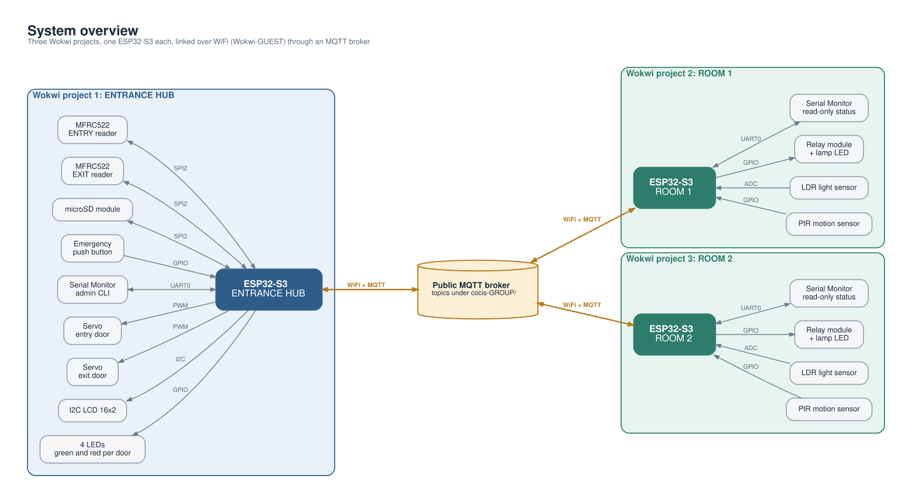
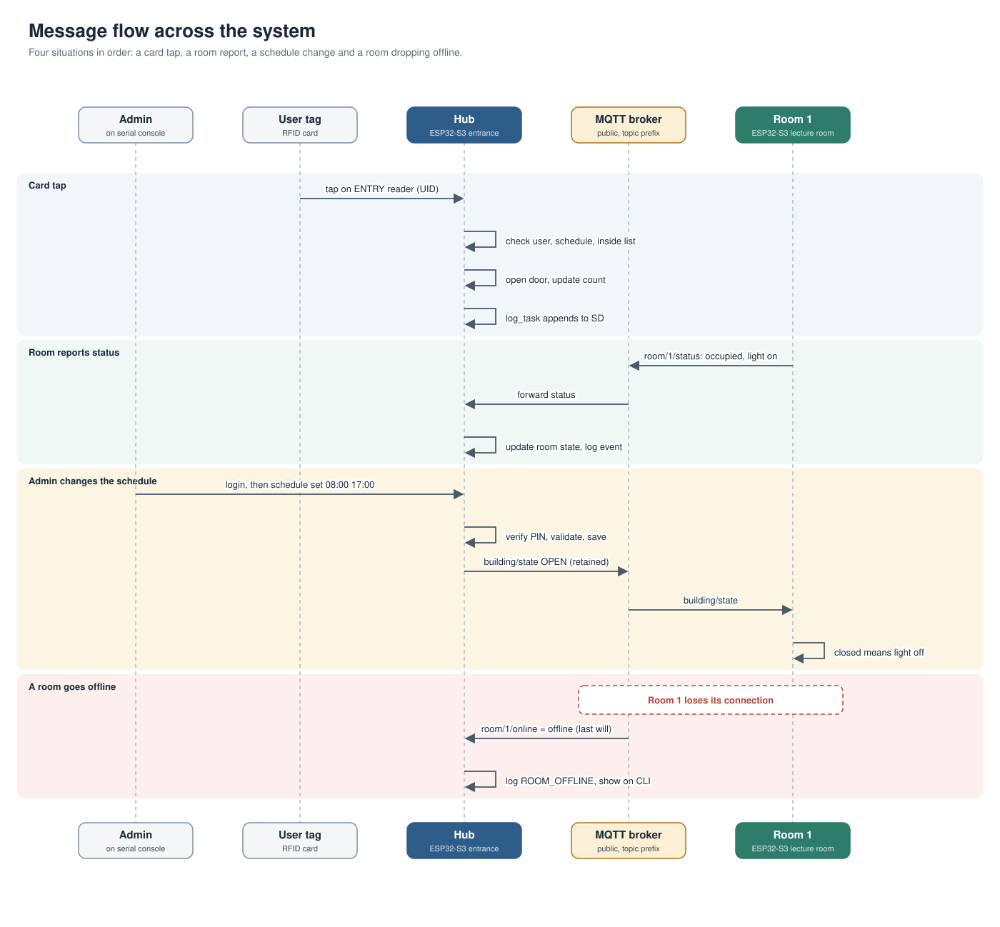
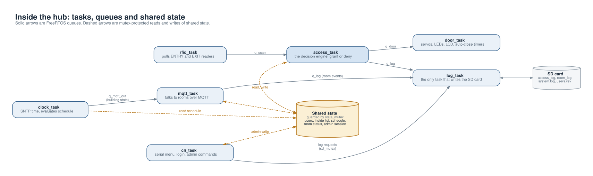
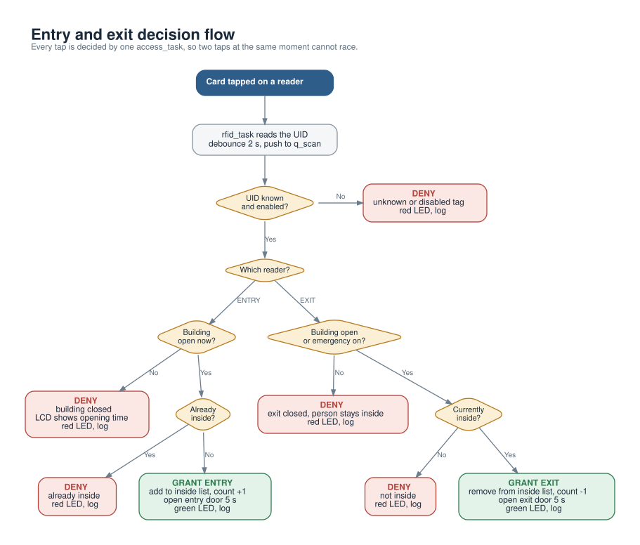
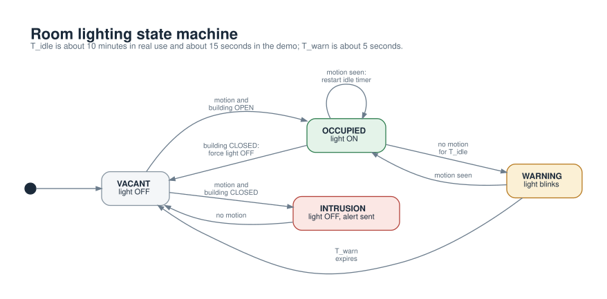

# CoCIS Smart Control and Monitoring System — System Operation Report

> Group name: <!-- add --> · Course: Embedded Systems · Date: <!-- add -->

*(Wokwi link, individual videos, member details and individual contributions are filled in the sections at the end.)*

---

## 1. The problem

CoCIS has two problems: **unauthorised access to equipment** and **wasted electricity from lights left on**. The system covers one building entrance and two lecture rooms. It must identify people with RFID at the doors, log who is inside, switch room lights by occupancy, enforce a configurable access schedule, store the data, and give management a serial menu — while several ESP32-S3 boards share this data without corrupting it.

Our answer is a **hub-and-spoke system**: one *entrance terminal* (the hub) owns all shared data, and two *room terminals* report to it over WiFi/MQTT. Only the hub ever changes the shared state, so there are no write conflicts by design.



---

## 2. Architecture

### 2.1 The three terminals

| Terminal | Board | Owns | Talks to |
|---|---|---|---|
| **Entrance hub** | ESP32-S3 | user table, inside list, schedule, all logs, room table | both rooms |
| **Room 1** | ESP32-S3 | its distance/PIR sensors and its light | the hub |
| **Room 2** | ESP32-S3 | its distance/PIR sensors and its light | the hub |

Each terminal is a separate Wokwi simulation running at the same time. Rooms never touch the SD card and never change configuration — they only report status and follow the building state.

### 2.2 Communication

The boards talk over **WiFi (Wokwi-GUEST) through MQTT** on a public broker (`broker.emqx.io` or a local Mosquitto instance — one config line).

The topic design follows one rule: **nobody subscribes to its own topic**, which is what removed the echo problem from the earlier test firmware:

| Topic | Direction | Payload | Retained | QoS |
|---|---|---|---|---|
| `cocis-g1/building` | hub → rooms | `open inside=N` / `closed inside=N` / `emergency inside=N` | yes | 1 |
| `cocis-g1/rooms/<id>/status` | room → hub | `occupied=<0/1> light=<0/1>` | no | 0 |
| `cocis-g1/rooms/<id>/alert` | room → hub | `INTRUSION` | no | 0 |
| `cocis-g1/rooms/<id>/online` | room → hub | `<client-id> online` / `<client-id> offline` (last will) | yes | 1 |

- `<id>` is the last three bytes of the board's MAC address (e.g. `000116`), read from the Wokwi board attributes — the same firmware serves both rooms, only the simulated MAC differs, so there is no copy-pasted room code.
- **Retained** messages mean a room or hub that joins late still gets the last building state immediately, without waiting for the next cycle.
- **The last will** (LWT) means the broker publishes `offline` for a room that disappears — this is how the hub's room table learns a terminal is gone.



### 2.3 Why hub-and-spoke

A peer-to-peer or "everyone writes the schedule" design would need distributed agreement. With a hub, the answer to *every* conflict question is the same: *what does the hub's copy say?* That is easy to build in the time we had and easy to explain in the presentation.

---

## 3. Hardware components and wiring

### 3.1 Entrance hub

| Component | Qty | Purpose |
|---|---|---|
| ESP32-S3 DevKitC-1 | 1 | the hub |
| MFRC522 RFID reader | 2 | entry reader + exit reader, both on one SPI bus with separate chip-selects |
| SG90 servo | 2 | one per door actuator |
| 16×2 LCD (I2C, PCF8574) | 1 | shows Welcome/Denied, live occupancy count and time |
| LEDs (green + red) | 4 | per door: permitted / denied |
| — | — | emergency-unlock button (planned, GPIO 40) |

Shared SPI wiring for both readers: SCK 12, MOSI 11, MISO 13, RST tied to 3V3 (soft reset in the driver); chip selects are 10 (entry) and 9 (exit). Servos 15/16 (LEDC 50 Hz), LCD on I2C pins 17/18 at address 0x27, LEDs on 1, 2, 38, 39. Strapping pins 0/3/45/46, USB pins 19/20 and flash pins 26–37 are avoided.



### 3.2 Room terminal (×2)

| Component | Purpose |
|---|---|
| HC-SR501-style PIR sensor | detects *movement* of a warm body |
| HC-SR04 ultrasonic sensor | detects a *stationary* object in the room (covers the PIR's blind spot: people sitting still) |
| Photoresistor (LDR) module | daylight check — the light stays off when the room is already bright |
| LED + resistor | stands for the switched light |

Room pins: PIR 4, light LED 5, LDR 6, HC-SR04 trig 7 / echo 15.

---

## 4. Software design

### 4.1 Where everything lives

One repository, one ESP-IDF project per board. The group's shared code sits in the repository root; the `sim/` folders contain earlier iterations and the member sandboxes:

```
automated-lighting-control/        (this repository — the group's shared code)
├── main/                          the entrance-hub firmware (one file per responsibility, §4.2)
├── components/management/         serial console module (member E): schedule, admin login, CLI
├── sim/room_1/                    room terminal 1 (diagram.json, MAC …:01)
├── sim/room_2/                    room terminal 2 — same code as room 1, MAC …:02
└── docs/                          this report and the diagrams
```

Both room projects contain **identical firmware**; only the board's simulated MAC address in `diagram.json` differs, which is what the hub reads to tell the rooms apart. There is no copy-pasted room code variant.

### 4.2 Hub firmware: one file per responsibility

| File | Responsibility |
|---|---|
| `app_main.c` | `app_main` — starts everything, nothing else |
| `net.c` + `app_config.h` | WiFi, SNTP clock and the MQTT client, behind a small interface (`net_start`, `net_publish`, `net_publish_retained`, `net_time_ok`) |
| `rfid_reader.c` | polls both MFRC522 chips over SPI, reads card UIDs, debounces repeats, and pushes `{door side, UID}` events into a queue |
| `access_ctrl.c` | **the decision engine** — one task, one queue, the only place a door may be opened. Runs the checks listed in §5 |
| `occupancy.c` | the "currently inside" list, protected by a mutex |
| `door_ctrl.c` | one task owning all door hardware: servos, LEDs, LCD messages, auto-close timers, emergency hold-open |
| `lcd_i2c.c` | 16×2 I2C display driver |
| `rooms.c` | the hub's view of the rooms — rows with occupied/light/online, filled from incoming MQTT messages |
| `building.c` | publishes the retained building state (`open/closed/emergency inside=N`) |
| `storage.c` | (member B) the SD card: loads `users.csv` into RAM at boot, rewrites it when a user is added or removed, appends access/room/system events to log files, and degrades gracefully if the card is absent |
| `management_bridge.c` | half-page glue that maps the console module's schedule and override state onto the interfaces the decision engine uses |

Member contributions meet through two narrow seams rather than one big shared file:

- `hub_interfaces.h` declares what the decision engine needs from the others: `user_lookup()` and `log_access()` (member B, implemented in `storage.c`), `schedule_is_open()` and `override_active()` (member E, bridged to the management component).
- The management component (member E) registers only `management_init()` / `management_start_cli()` in `app_main`; everything else it does is behind its own header.

### 4.3 Room firmware

`room_main.c` starts the light logic and the network; `light.c` runs one task every 100 ms that implements the state machine in §6, plus a status/alert publisher.

---

## 5. Access control flow

Two scanners (ENTRY and EXIT) feed one queue, and a single `access_task` makes every decision — one decision-maker means two near-simultaneous taps can never race, and the "who is inside" list stays consistent.

**The full flow** (3-access-flow.svg): idle screen → a card is tapped → debounce (same card + same reader within 2 s is ignored) → decision in this exact order:

1. **Emergency override on?** → at the EXIT, everyone may leave (`ACCESS_EMERGENCY_EXIT`). This exists because the raw spec traps people inside when the building closes, which is unsafe in a fire.
2. **Card known?** → otherwise `DENIED_UNKNOWN`
3. **Card enabled?** → otherwise `DENIED_DISABLED`
4. **Building open?** → otherwise `DENIED_OUTSIDE_HOURS` — and this applies to *exits too*, per requirement 2.6: people inside cannot leave outside the permitted period
5. **Anti-passback** — entering while already inside, or exiting while not inside, is refused. This keeps the inside list trustworthy
6. Otherwise **granted**: update the occupancy list, LCD "Welcome/Goodbye *name*", green LED, servo open for 5 s (non-blocking), event logged with the reason

Denials show the exact reason on the LCD, light the red LED for 2 s, and are logged with their reason — the log line tells you whether the *reader*, the *decision* or the *table* failed, which halves debugging time.



The scheduled period is configurable by authorised personnel only (member E): an admin logs in over the serial menu (password stored as a salted hash, lockout after repeated failures) and changes the window with a CLI command; the schedule change is itself logged.

---

## 6. Automated lighting flow

Room logic runs a state machine every 100 ms (room-states.svg):

1. **Presence** = PIR motion **OR** an ultrasonic object closer than 250 cm in the beam. The two sensors cover each other's weaknesses (PIR misses still people; ultrasonic misses nothing in the beam).
2. **Building open:** presence turns the light on if the LDR says the room is dark. Every detection of presence restarts a **vacancy timer** (15 s in the demo; 10 min in a real room) — because a PIR cannot see a person sitting still, the room that becomes "vacant" after the timeout may not truly be; so before switching off, the light **blinks for 5 s as a warning**, and waving at the sensors cancels it.
3. **Building closed:** the light is forced off, the occupancy flag is cleared, and any presence raises an **INTRUSION alert** to the hub (at most one per 10 s).
4. **Room status** is published every 5 s to `.../<id>/status`, and **online** on every MQTT connect, so a hub that boots after a room still shows the room correctly (retained online message + periodic status).



---

## 7. Synchronisation design

The hub is one board running several parallel activities (the decision engine, the MQTT callback, the RFID polling task, the door/hardware task, the console, and the main reporting loop), and at the same time the system is three boards running at once. Section 2.3 explained why no *distributed* state is ever modified from two terminals; this section documents the *local* concurrency rules that keep the hub's own data coherent, and the rule book that made the choices reviewable before any of them were needed.

### 7.1 The design rules

Three rules cover every shared object in the system, and each shared object was assigned exactly one of them:

**Rule 1 — One owner task (single-writer-per resource).** A resource that only one task will ever touch gets no lock at all; instead the code **is structured so only that task can reach it**. Physical interfaces fit this rule naturally: the LCD, servos and door LEDs are driven only from the door task, the RFID chips only from the RFID task, and the decision state only inside the decision task. The rule is enforced by structure, not by thought: a race would require someone to *add* a second caller.

**Rule 2 — Message queues at task boundaries.** Whenever two tasks communicate, they exchange a *copy* of a small event through a FreeRTOS queue, never by sharing a variable. The queue hands ownership of the data over — the sender forgets the event, the receiver owns it. Two properties were chosen deliberately:
- Queues are created **before** the producing tasks start, so there is no window in which a send can fail on an uninitialised handle, and the start-up order pins this (network → storage → decision engine → RFID).
- Sends use a **zero-timeout**, meaning events are *dropped, not queued forever*, when the receiver falls behind. This is a stated policy: during a jam, losing the 3rd tap of the same card in 10 s (which the debouncer would have dropped anyway) is better than any task stalling — and drops are logged loudly, not silent.

**Rule 3 — Mutexes for multi-reader, multi-writer state.** The two tables that genuinely have several users — the "currently inside" list and the room table — get one FreeRTOS mutex each, taken by **every** read and write, including small ones like the inside-count. Two supporting conventions matter more than the mutex itself:
- *Copy-out on read*: readers receive a consistent snapshot (a copy made while holding the lock), so they never iterate a table that another task is mutating, and never hold the lock while they work on the copy.
- *Work outside the lock*: slow operations (writing to the SD card, publishing to MQTT) are done after the mutex is released, so a slow SD card can never keep the decision engine or the MQTT callback waiting — it only makes that one log line late, never blocks the state change itself.

### 7.2 How each shared object is built

| Shared object | Written by | Read by | Design rule applied |
|---|---|---|---|
| Inside list (occupancy) | decision task only | decision task, door task (display), console | Rule 3 (mutex + copy-out) |
| Room table | MQTT callback only | reporting loop, console | Rule 3 (mutex + copy-out) |
| Scan events | RFID task | decision task | Rule 2 (queue) |
| Door commands | decision task | door task | Rule 2 (queue) |
| Door hardware (servos/LEDs/LCD) | door task only | — | Rule 1 |
| RFID chips + reader state | RFID task only | — | Rule 1 |
| Log files (SD) | see §7.3 | nobody (append-only) | Rule 1, one writer per file |
| User table (RAM cache of `users.csv`) | console (add/remove) | decision task | Rule 3 (mutex) — lookups and table changes never overlap; the SD rewrite happens outside the lock so the decision task is never blocked by the card |
| Schedule / override state (member E) | console task | decision task, reporting loop, door task | Rule 3 (mutex): the whole schedule is written under one lock, so every read sees a consistent open/close pair |
| MQTT client | all tasks publish | — | component-internal locking (built into the ESP-IDF MQTT client, not our code) |

The RAM-cache choice for the user table is Rule 1 carried into storage: the card is touched only at boot (to load) and when a user is added or deleted (to rewrite). Lookups — by far the most frequent operation — happen purely in RAM, so the SD bus is never on the decision's critical path.

### 7.3 Storage concurrency: one writer per file

SD-card writes are the system's slowest operation (tens of milliseconds), so instead of locking them we made every log file **append-only with exactly one writing task**:

- `access_log.csv` — written only by the decision task, after a decision is final (never inside any lock, never blocking the door action queue)
- `room_log.csv` — written only from the MQTT callback context
- `users.csv` — rewritten only by the user-management code path

Because file handles are opened fresh per write and no two tasks ever open the same log, no file-system locking is relied on at all — the concurrency guarantee is structural. A side effect of "open–write–close per line" worth stating: a crash or glitch can lose at most the line being written, never the file's earlier contents.

The **failure policy** is fail-fast, by design: if the card fails, logging is disabled for the rest of the run (with one error), while access control continues to *decide* and *display* normally. An audit log we cannot trust is worse than a stopped one; locking people out because their log disk died is not acceptable behaviour for a door system.

### 7.4 Distributed synchronisation (spec 2.7)

The three boards never modify the same variable at the same time *by topology*: rooms only publish, the hub is the single writer of the inside list, schedule and logs. The remaining distributed questions — what does a new or restarting terminal know, and when does a dead one learn to be quiet — are delegated to two broker features rather than to any code we had to write:

| Concern | Mechanism |
|---|---|
| Late join / reconnect misses state | every important message is **retained** (building state, room online flags): a subscriber gets the last value the instant it subscribes |
| A terminal dying silently | MQTT **last will**: the broker publishes `<room> offline` the instant the TCP connection drops, even mid-crash |
| Two taps arriving at once | Rule 2: they queue; the single decision task serialises them by construction |
| Duplicated card reads | per-reader debounce before an event even enters the queue |
| Topic echo (receiving your own state) | topic naming: nobody subscribes to a topic they publish (§2.2), so no loop is possible |
| WiFi loss mid-operation | the hub keeps deciding and displaying without a network; state resumes from the retained messages on reconnect |
| Definitive clock | every board runs SNTP; log timestamps are stamped by the hub, and a boot before SNTP succeeds marks its rows `no-time` rather than stamping a lie |

### 7.5 What we did not do, on purpose

- **No global lock guarding "everything"** — a coarse mutex around the entire hub would be easier to reason about but would serialise RFID polling, MQTT handling, door animation and SD writes behind each other; the per-object scheme keeps each slow subsystem isolated from the others.
- **No interrupt-driven access to shared state** — every sensor goes through its own task and a queue; no ISR touches a table or list, which removes a whole class of bugs.
- **No distributed locking protocol** — with one logical writer per datum (§2.3, §7.3), there is nothing for two terminals to contend over; correctness is bought by topology, which is much cheaper than by protocol.

---

## 8. Requirements → features traceability

| Req | Requirement | Where implemented | Status |
|---|---|---|---|
| 2.1 | Access control + occupancy monitoring | `rfid_reader` + `access_ctrl` + `occupancy` + `door_ctrl` on the hub | **working** |
| 2.2 | Automated lighting by occupancy | `light.c` per room (PIR + ultrasonic + LDR + vacancy/warning) | **working** |
| 2.3 | Distributed control, 3 terminals | hub-and-spoke over MQTT; `net.c`, `rooms.c`, `building.c` | **working** |
| 2.4 | SD card data storage | `storage.c` — mounts the card, RAM-cached `users.csv`, three append-only log files | **working** |
| 2.5 | Serial interface and menus | `components/management` (member E) — admin login, schedule and user commands, table dumps | **working** |
| 2.6 | Configurable access schedule + auth | management component: hashed PIN, lockout, schedule change from the console, emergency override | **working** |
| 2.7 | Synchronisation without conflicts | mutexes, single queue, single door task, single-writer rule, LWT, retained state | **working** |

---

## 9. Demonstration guide

Wokwi card presets map to the user table: **Blue** = Alice (admin), **Green** = Bob (staff), **Yellow** = Carol (student), **Key Fob** = Dave (disabled card), **Red** and the **NFC tag** = unknown on purpose.

| Scenario | Expected |
|---|---|
| Blue on ENTRY | granted, inside count +1, LCD "Welcome Alice", door opens 5 s |
| Blue on ENTRY again (after 2 s) | "Already inside", red LED |
| Blue on EXIT | granted, count −1 |
| Blue on EXIT again | "Not inside" |
| Red on ENTRY/EXIT | "Unknown card" |
| Key Fob | "Card disabled" |
| Same card twice within 2 s | second tap ignored (debounce) |
| Green card after schedule closes | "Outside hours" — entry *and* exit both refused |
| Wave in a room | light on (if dark); light blinks after vacancy timeout, then off |
| Wave in a room while the building is closed | light stays off, hub logs INTRUSION |
| Stop a room simulation | hub marks that room offline instantly via last will |

---

## 10. Known limitations (stated honestly)

- On a public broker the topic prefix acts as a group identifier, not as security — a production system would use a private broker with TLS and authentication.
- The admin PIN is visible while typed on the serial monitor (UART cannot un-echo its input); this is stated rather than hidden.
- An exit refused for non-emergency reasons is finally only unlocked by the authenticated emergency override — the safety trade-off is documented in §5.

---

## 11. Wokwi simulation links

> <!-- paste the three links: hub workspace, room 1 workspace, room 2 workspace -->

## 12. Individual video demonstrations

> <!-- one link per member -->

## 13. Individual contributions

> ## Member A — Entrance access control
> <!-- 3–4 sentences: what they built (rfid_reader, access_ctrl, door_ctrl svg scope...) -->

## 14. Group member details

> <!-- Name · Student No · Role -->
